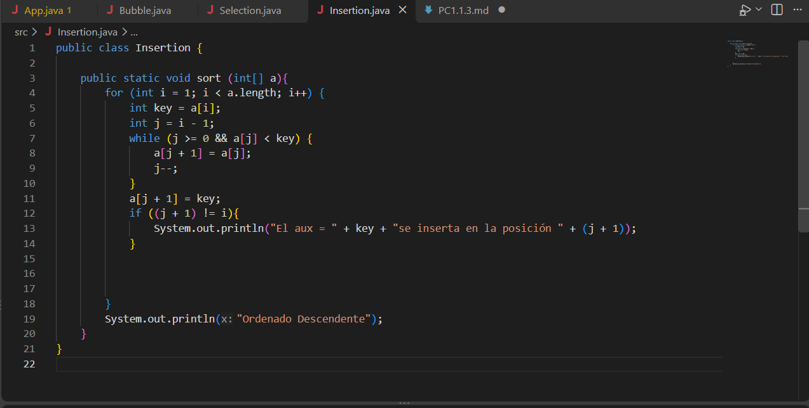
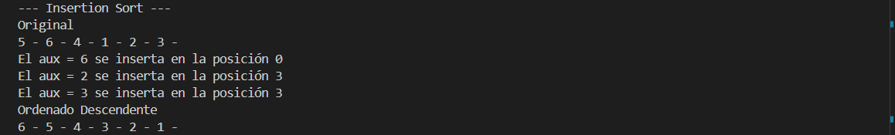

## PC 1.1.3

21 de octubre del 2026

## 1 Captura del código:

## 2 Explicacion de como se muestra los resultados:

 Mediante un condicional simple, se verifica si el elemento guardado en el auxiliar, cambio de posición dentro del arreglo, por lo tanto impreme el arreglo y ordenado.

## 3 Captura Terminal

